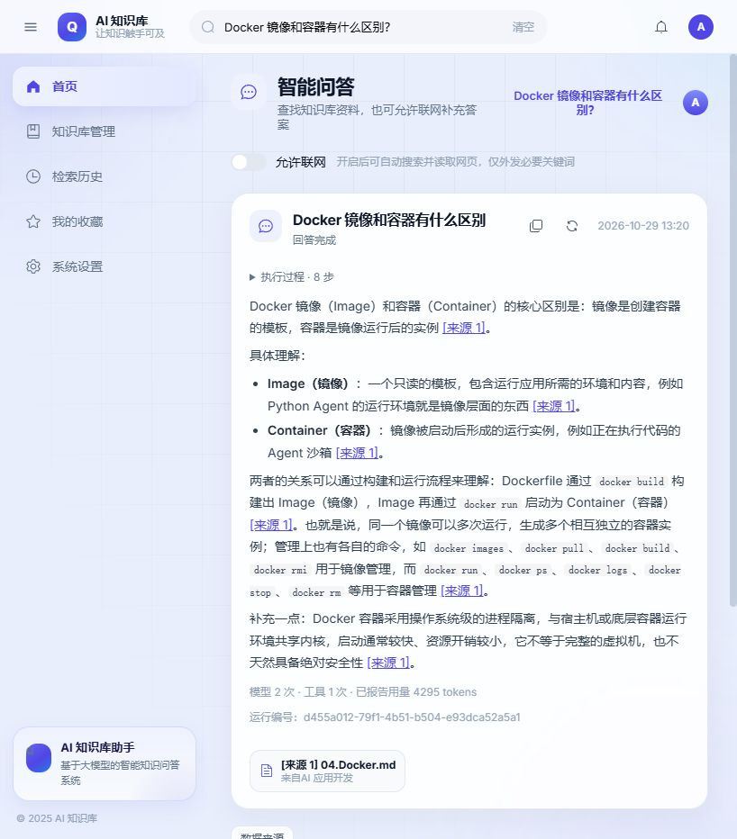

# 第六阶段实施与验收记录

日期：2026-10-29（Asia/Shanghai）。

后续质量优化：已另跑完整 100 题，同一补词标准下正确率由 50.00% 提高到 65.56%，启发式幻觉疑点率由 9.59% 降到 1.33%，拒答正确率由 30% 恢复到 100%；仍有 26 次运行错误，未达到历史质量门槛。本页保留原阶段归档，最新原因分析与前后对照见 [问答质量优化报告](rag-quality-optimization-report.md)。

后续补词记录：90 道可答题已补齐显式等价表达，评分已接入逐项命中明细。按同一新规则离线对照，历史为 94.44%，最终轮仍为 50.00%；仅计正常完成则最终轮为 47.78%。本页下表保留原阶段归档数值，原始实测未覆盖；补词不能证明质量恢复。详见 [关键词补齐与复评](keyword-scoring-review.md)。

本阶段的评测改造、两轮黄金题集、联网与跨库实测、来源核对、异常检查、镜像构建、显式迁移、部署核验和运行文档整理已执行完毕。**最终质量验收未通过，不能将整个重构标记为最终验收完成。** 原题集、历史结果、存量资料、模型与执行预算均未为过关而改写。没有提交或推送 GitHub。

## 本轮确认的范围

开始时工作区干净。用户明确授权修改评测脚本、增加联网场景和修订相关失效测试；确认门槛为历史质量不退步、遵守已批准执行预算，费用只记录用量。

历史基线是 2026-10-11 保存的结果，不能证明当时与当前千问配置完全一致。知识库原文件、题目及历史每题知识库范围保持一致，但新协议允许说明资料不足，历史固定“我不知道”改为明确 insufficient 终态；纯关键词和文本重合仍只作辅助。新报告把非正常运行计入失败，另列错误数，不能将数值差异完全归因于模型能力。

## 交付内容

- 评测请求移除旧 chunk_ids；独立检索只评 Hit/MRR，答案证据直接读取同次后端快照，核对响应与快照一致。删除评测端扩邻块重造证据的路径。
- 离线重评分在登录与网络之前分支，只读保存的题目、回答、检索和实际送模材料；保留重评分前摘要与原始快照。失败逐题落盘，结果文件不自动覆盖，同一时间仍只运行一轮。
- 新增引用映射、原文范围、资料身份、工具选择、重复调用、事件次序、停止原因、实际/估算用量与延迟指标。新增只读版本审计，不用重新抓取后的网页替换历史证据。
- 模型输入只携带正文及必要来源身份，完整分块映射和真实评分保留在 API 与快照；按单次输出额度为后续工具记录预留估算空间。系统提示合并为一条，并明确本次联网范围和参数类型。没有放宽引用、字符串转数组、任意文本解析工具调用或强迫作答重试。
- 本机快照额外保存最终响应，便于解释 JSON/引用拒绝；仍不保存模型 reasoning_content 或工具轮内部解释，不把拒绝答案发布给页面。模型 401/403 与 429 有安全的机器可读错误，评测可停止额度/权限失败。
- 删除未使用的模型逐字流式接口、ChatChunk 及适配器代码；前后端运行说明改为协议 v4、过程实时而最终答案一次发布。Python 安装、依赖锁定、镜像和诊断提示统一 uv。
- Docker 使用固定版本 uv、uv.lock、/opt/venv 和独立依赖缓存层。构建上下文排除本地环境、密钥和运行快照；采用官方 HTTPS 软件源，删除旧编译器和 MuPDF 开发包，保留 OCR/OpenCV 所需运行库。

## 本次配置清单

| 项目 | 配置 |
|---|---|
| 对话 | openai 兼容协议；qwen3.8-flash；千问既有服务地址 |
| 嵌入 / 重排 | qwen3.7-text-embedding-flash，1024 维 / qwen3.7-text-rerank；不重嵌入存量向量 |
| 网页 | Tavily Search / Extract，单次供应商超时 20 秒；只外发必要公开关键词 |
| 来源与工具范围 | 用户已选且有权访问的库；联网默认关闭，开启后可选择搜索和读取；无其他外部工具 |
| 程序上限 | 模型 6 次、工具 10 次、总时限 120 秒；输入 16000、输出 2048、累计扣减 64000 |
| 输入计量 | utf8_bytes_estimate，保守估算；实际 usage 独立记录，不是精确千问分词器 |
| 部署 | 单后端进程；PostgreSQL + pgvector、Redis；原有数据库卷和上传卷 |
| Python | uv 0.11.26，uv.lock；镜像环境 /opt/venv，不被 /app 源码挂载覆盖 |
| 保留 | 服务快照本机七天；评测导出显式留档，无恢复执行能力 |

密钥只从既有本地 .env 注入，未写入报告、评测文件或镜像。具体变量名和运行命令见 [配置模板](../../ai-service/.env.example) 与 [README](../../README.md)。

## 黄金题集结果

数据：[历史基线](../../eval/last_run.json)、[首轮](../../eval/phase-6-golden-results.json)、[修正后最终轮](../../eval/phase-6-final-golden-results.json)。两轮均完整执行 100 题，未挑题替换完整结果。

| 项目 | 历史 | 首轮 | 最终轮 |
|---|---:|---:|---:|
| Hit@5 / Hit@10 / MRR | 1 / 1 / 1 | 1 / 1 / 1 | 1 / 1 / 1 |
| 关键词正确率，运行失败记错 | 91.11% | 44.44% | 50.00% |
| 拒答正确率 | 100% | 20% | 30% |
| 启发式幻觉率 | 1.11% | 10.96% | 9.59% |
| 请求或非正常运行数 | 0 | 52 | 50 |
| 正常 completed | 历史协议无此字段 | 40 | 43 |
| 资料不足 insufficient | 历史固定拒答 | 8 | 7 |
| 预算停止 | 历史未记录 | 37 | 39 |
| 无效最终格式/引用 | 历史未记录 | 12 | 10 |
| 工具失败 / 超时 | 历史未分开记录 | 3 / 0 | 0 / 1 |

最终轮 90 个可答题中，76 个回答包含要求关键词，但只有 43 个同时正常完成，说明关键词命中不能独立充当最终质量验收。上表 50% 也不等于语义正确率：部分 insufficient 正文仍可能提到题目关键词。

| 最终轮资源项目 | 实测 |
|---|---:|
| 模型 / 工具调用 | 275 / 175 |
| 实际已报告输入 / 输出 tokens | 591316 / 34808 |
| 保守输入估算 / 累计扣减 | 2425111 / 2461967 |
| 未报告用量的模型调用 | 1 |
| 单次实际输入 / 输出峰值 | 3814 / 601 |
| 延迟 p50 / p95 / 最大 | 7.813 / 12.063 / 33.188 秒 |
| 实际重复执行相同动作 | 0 |

真实输入峰值远小于 16000；保守 UTF-8 字节估算仍会提前耗尽可用空间。实际 token、估算值、预算扣减不是同一个量；未知调用也不能冒充零消耗。以上只是最终黄金轮用量，不包含首轮、诊断、联网及页面校验，也没有虚构货币金额。

本阶段全部显式归档记录按 `run_id` 去重后共 **222 次运行、603 次模型调用、360 次工具调用**；已报告输入 1,450,090 token、输出 71,130 token，保守输入估算合计 5,475,614、累计扣减 5,552,888。另有 3 次模型调用的实际用量未知。这份汇总包含两轮完整题集、联网、跨库、诊断、页面与部署后接口实测；不包含嵌入和重排计费、未归档请求以及取消后供应商可能继续执行的消耗，不等同于供应商账单。[去重清单](evidence/phase-6-usage-inventory.json)

## 联网、跨来源与语义

[联网场景](../../eval/web_scenarios.json)四题均真实调用，最终 2 个 tool_failed、2 个 budget_exhausted，**0/4 通过**。供应商搜索和正文读取均已实际成功：uv 官方页面取得 5000 字符，首轮搜索并读取 Tavily 官方 API 页面，最终轮取得 Docker 官方页面。旧的容器连接阻塞已解除，但不代表联网问答质量通过。

W01/W02 的主要问题是模型后续参数类型非法；W03 读到的网页在最终上下文只保留 312 字符，不能完成跨来源对照；W04 返回不相关评审网页，最终说明资料不足，但以预算终态结束。失败与无结果保持可区分，未切换供应商或伪造来源。[原始记录](../../eval/phase-6-final-web-results.json)

历史 F03 的 relevant_filenames 跨知识库 2 和 3，但旧评测只使用库 3。本次保留历史范围用于对照，另新增 [CROSS01](../../eval/cross_source_scenarios.json) 明确授权两个库，结果仍因资料覆盖和预算不足失败，不冒充通过。[补充结果](../../eval/phase-6-cross-source-results.json)

直接对照审阅了 16 个黄金题疑点、4 个联网场景与 1 个跨库场景，包含全部 7 个启发式疑点及多来源、冲突数字、无效格式和引用问题。发现既有证据外补充，也有可推导数字和文档元数据造成的启发式误报；没有因此改规则或下调自动得分。完整说明见 [语义抽查](phase-6-semantic-review.md)。这是有边界的抽查，不是全 100 题独立人工评级。

## 功能、数据与页面证据

| 验收项 | 结果与依据 |
|---|---|
| 原文与来源版本 | 首轮 184、最终轮 212 个知识库来源逐段匹配；文档版本、分块位置和字符范围一致。[最终审计](../../eval/phase-6-final-source-audit.json) |
| 网页来源 | URL、抓取时间、实际取得内容均保留；成功抓取但没有所需正文不计完成。[网页审计](../../eval/phase-6-web-source-audit.json) |
| 离线重评分 | 后端地址设为不可用端口，209 条记录重评分完成且运行快照逐一未变；单元检查另禁止登录/网络。[证据](evidence/phase-6-offline-rescore.json) |
| 预算与停止 | 所有最终题集动作均遵守次数、输入输出与时间上限；未发现停止后继续动作、相同动作重复执行或伪造相关性分。预算停止仍计失败。 |
| 失败与取消 | 确定性检查覆盖空结果、依赖错误、超时、预算、重复、无效引用、正在执行的模型/工具取消和未启动取消。实际页面与后端取消均对应运行 8cd7617d-1b9d-44e6-b597-c20a8417f90a。[快照](evidence/phase-6-ui-cancel.json) |
| 页面问答与引用 | 实际回答可打开送模片段、文档时间及原分块范围；同题重新生成产生新运行编号。页面未把失败正文当作正常回答。 |
| 旧缓存 | 使用历史 v11 的真实键植入错误检索及答案，页面仍创建新运行 d455a012-79f1-4b51-b504-e93dca52a5a1，未显示错误标记；植入缓存和临时页面均已清理。[记录](evidence/phase-6-old-cache-check.json) |
| 存量数据 | 6 库、29 文档、1153 分块、1153 向量；29 篇四个阶段全部 completed。29 份原文件与准备阶段备份逐一一致。[文件核对](evidence/phase-6-upload-integrity.json) |
| 前端构建 | npm run build（含 Vue/TypeScript）通过；只有已有第三方 PURE 注解提示。 |
| 后续记录空间 | 服务运行快照仍由七天清理器管理；本阶段显式保存的评测导出用于验收留档，属于私有材料，不自动提交上传。 |

## 测试文件变更清单

这些文件均在本轮用户明确授权后修改或新增，不改 golden_set.json 和历史评分关键词/陷阱。

| 文件 | 改动 |
|---|---|
| ai-service/tests/test_context_block.py | 删除已不存在的 build_context_block 调用，验证当前资料裁剪、字符范围与完整输入预算。 |
| ai-service/tests/test_rag_grounded_answer.py | 替换旧的强迫作答/旧构造器检查，覆盖真实循环的来源、终态、预算、取消、冲突版本和 SSE 快照一致性。 |
| ai-service/tests/test_relevance_gate.py | 固定资料补齐真实重排分类型；保持原术语规则预期。 |
| ai-service/tests/test_qwen_reranker.py、test_rerank_relevance.py | 清除旧 fallback 命名并整理异常检查；不改变分数预期。 |
| ai-service/tests/test_read_only_tools.py | 新增真实执行器参数、权限、空结果、故障与取消检查。 |
| ai-service/tests/test_model_protocol.py | 新增安全鉴权错误、原生协议和用量完整性检查。 |
| eval/test_faithfulness.py | 删除评测自行扩邻块的废弃检查，保留既有文本/数字/关键词规则。 |
| eval/test_run_lock.py | 使用真实锁持有者 PID，关闭输入后等待子进程退出，避免 Windows 虚拟环境启动器造成误判或孤立进程。 |
| eval/test_quota_abort.py | 补充新运行协议的权限/限流错误分类。 |
| eval/test_run_metrics.py | 新增实际证据、引用、预算、无网络重评分与缺失快照审计检查。 |

本机 47 项后端检查、24 项评测检查通过；相关 Python 编译、修改文件按项目配置的 Ruff 和 git diff --check 通过。文件字节检查无 BOM 或混合换行，新文本使用 LF；既有文件保持各自格式。未用修改 Git 换行配置或归一化索引隐藏 autocrlf 提示。资料留空间的回归检查在 HEAD 旧实现上失败、当前实现通过，未更改工作区生产文件制造通过。[检查记录](evidence/phase-6-checks.json)、[回归证据](evidence/phase-6-headroom-regression.json)

## 部署验收

镜像构建、镜像内功能检查、显式迁移、启动与部署后接口实测已通过。构建及迁移记录见 [部署证据](evidence/phase-6-deployment.json)，实际接口响应与同次运行资料见 [接口实测](evidence/phase-6-deployment-smoke.json)。

| 项目 | 结果 |
|---|---|
| 构建与运行镜像 | `docker-ai-service` 构建完成；运行容器与已核验镜像 ID 一致。uv 0.11.26、Python 3.11.18，依赖位于 `/opt/venv`。 |
| 镜像内功能 | 非 root 运行；PDF 文字提取、OCR 初始化及空白图推理通过；20 个源码文件匹配。未包含本地密钥文件、实际 API Key 或宿主虚拟环境。 |
| Linux 后端检查 | 重建后的镜像内检查退出码为 0；本机已有的 47 项后端与 24 项评测检查记录另见上节。 |
| 显式迁移 | 停止原后端后运行 `uv run --no-sync python -m cmd.migrate`，成功退出，再以新镜像启动；保留原数据库与上传卷。 |
| 部署后真实问答 | 运行 `604f58c1-826e-45ba-843d-f286b5f02389`，终态 `completed / answer_completed`，2 次模型、1 次知识库工具调用，耗时 12.765 秒。证据、引用映射、预算、事件次序与工具范围检查通过；这一题不能替代完整质量验收。 |
| 重启后核对 | 2026-10-29 18:51（Asia/Shanghai）后端 healthy、数据库和 Redis 就绪，1153 个分块关键词索引已重建；29 篇文档的四个入库阶段均 completed。 |
| 数据与原文件 | 仍为 6 库、29 文档、1153 分块和 1153 向量；上传卷内 29 份原文件的大小及内容校验值与准备阶段备份全部一致。 |
| 前端恢复 | 已恢复本机 Vite；`http://localhost:5173/` 返回 200，前端 API 代理正确到达后端并对未登录请求返回 401。之前的实际页面回答、引用、取消和旧缓存证据继续保留。 |

Docker 重启后的检查为只读核对，未再调用模型、网页搜索或嵌入接口，见 [重启检查](evidence/phase-6-restart-check.json)。完整在线题集运行在依赖锁定和镜像重建之前；重建后只做了镜像内检查和单题真实接口实测，不能声称已在最终锁定镜像上重新完成整套质量评测。

## 未通过项与后续边界

1. 数值质量门槛未过；检索排名通过不能抵消正常完成率、拒答和引用语义问题。
2. 需要取得针对当前千问模型可核查的输入计量方案，并改善多轮资料选择、去重和预算分配；不能直接把保守字节估算除以任意系数冒充精确 token。
3. 模型有时不遵守最终 JSON 或工具参数类型；需要在已确认供应商能力内验证更可靠的输出约束。当前没有引入自然语言模拟工具、自动参数转换或隐蔽重试。
4. 网页取得成功不代表正文含所需信息；需要改善长页面内容定位和多来源覆盖，不能把标题、界面或搜索摘要冒充正文。
5. 完整题集未再无界重跑以筛出一轮好结果；模型、供应商、已批准预算和验收门槛未擅自改变。保存的失败是后续修正与复验的依据。

运行与迁移命令见 [README](../../README.md)，评测与离线复算见 [评测说明](../../eval/README.md)。
